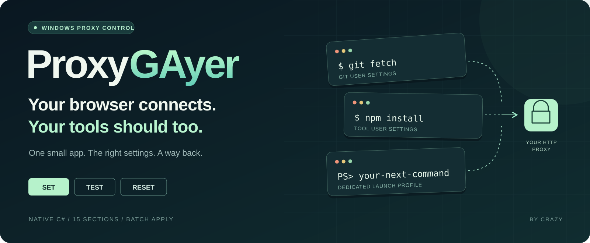
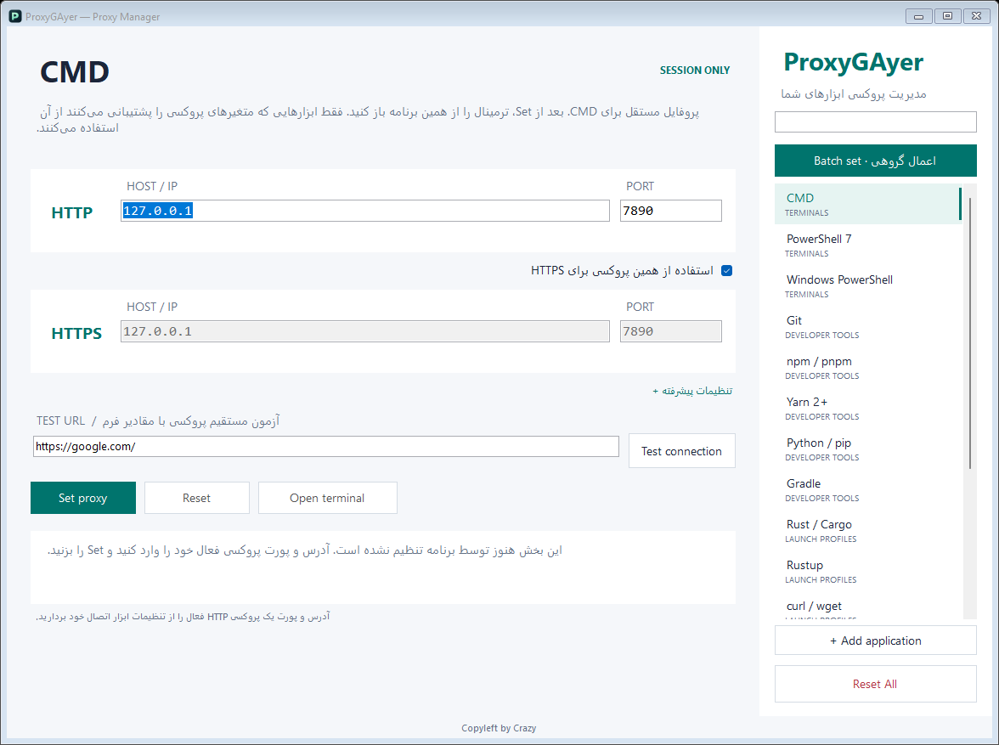
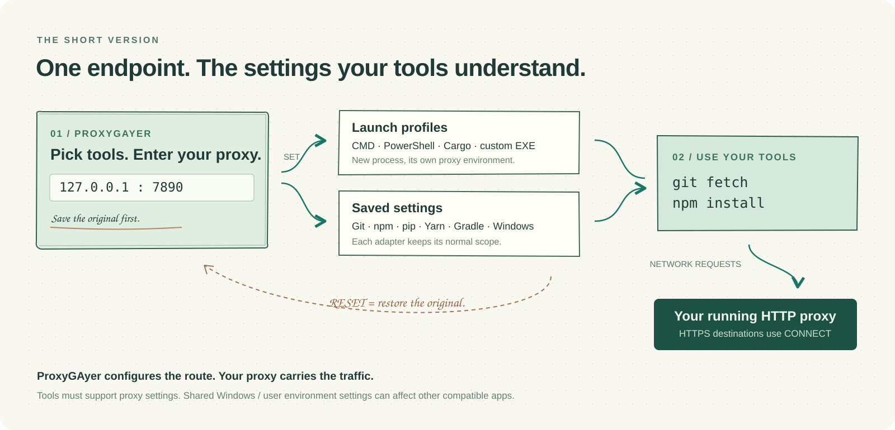
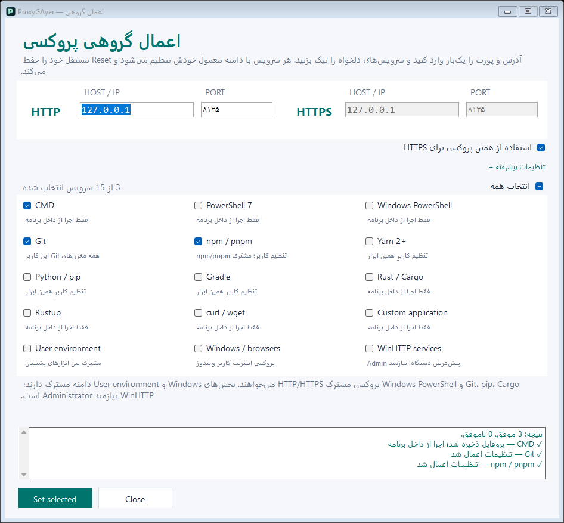
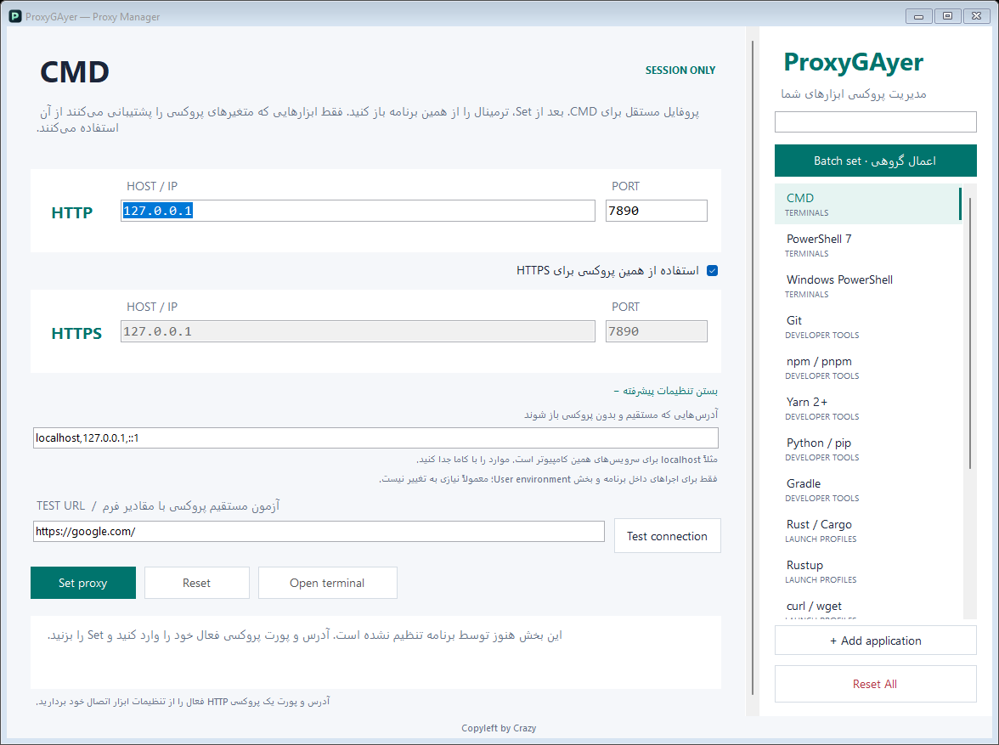

<p align="center">
  
</p>

<h1 align="center">ProxyGAyer</h1>

<p align="center">
  <strong>پروکسی را وارد کن. ابزارها را انتخاب کن. راه برگشت را هم داشته باش.</strong><br>
  یک برنامهٔ سبک ویندوزی برای تنظیمات پروکسیِ پراکندهٔ ابزارهای توسعه.
</p>

<p align="center">
  <kbd>Windows 10 / 11</kbd> &nbsp; <kbd>C# · WinForms</kbd> &nbsp; <kbd>۱۵ بخش آماده</kbd> &nbsp; <kbd>اعمال گروهی</kbd>
</p>

<p align="center">
  <a href="#quickstart">شروع سریع</a> ·
  <a href="#batch-apply">اعمال گروهی</a> ·
  <a href="#supported-tools">ابزارهای پشتیبانی‌شده</a> ·
  <a href="#troubleshooting">رفع مشکل</a> ·
  <a href="README.md">English</a>
</p>

<div dir="rtl">

---

## مرورگر وصله. Git هنوز منتظره. آشناست؟

پروکسی روشن است. مرورگر کار می‌کند. اما `git fetch` تایم‌اوت می‌شود، `npm install` جلو نمی‌رود و ترمینال جدید با قبلی فرق دارد.

**ProxyGAyer این تنظیمات را یک‌جا جمع می‌کند.** ابزار را انتخاب کن، آدرس و پورت پروکسی را بده و تنظیمش کن، اتصال را آزمایش کن یا به حالت قبل برگردان. برای چند ابزار هم یک‌بار اطلاعات را وارد کن و تیکشان را بزن.

</div>

<p align="center">
  
  <br><sub>تصویر واقعی برنامه با اطلاعات نمایشی؛ رابط فارسی و نام ابزارها انگلیسی است.</sub>
</p>

<div dir="rtl">

## کمتر دنبال دستورهای تنظیم پروکسی بگرد

| دردسر | راه‌حل در برنامه |
| --- | --- |
| هر ابزار یک دستور و فایل تنظیمات متفاوت دارد | آدرس، پورت و **Set proxy**؛ هر بخش روش تنظیم همان ابزار را اجرا می‌کند. |
| یک پروکسی را برای چند ابزار تکرار می‌کنی | **اعمال گروهی** با چک‌باکس جدا و گزینهٔ **انتخاب همه**. |
| معلوم نیست «گلوبال» دقیقاً روی چه چیزی اثر می‌گذارد | دامنهٔ اثر هر بخش، از پروفایل اجرا تا تنظیمات مشترک ویندوز، مشخص است. |
| یادت نیست قبل از تغییر چه تنظیمی داشتی | **Reset** وضعیت قبل از اولین Set را برمی‌گرداند؛ **Reset All** بخش‌های تنظیم‌شده را بررسی می‌کند. |
| تنظیم ذخیره شده ولی اتصال برقرار نیست | **Test connection** یک درخواست واقعی HTTP یا HTTPS از مسیر پروکسی می‌فرستد. |

رابط برنامه بومی Windows Forms است، بستهٔ NuGet شخص ثالث ندارد و سرویس پس‌زمینه اجرا نمی‌کند. خروجی فعلی از .NET Desktop Runtime نصب‌شده استفاده می‌کند تا بستهٔ خود برنامه کوچک بماند.

<a id="quickstart"></a>

## شروع سریع

### دانلود ریلیز

در بخش [Releases](https://github.com/SprTybi/ProxyGAyer/releases) نسخهٔ دلخواه را انتخاب کن:

- **EXE مستقل یا Standalone:** دات‌نت داخل فایل قرار دارد؛ همان یک فایل را اجرا کن.
- **EXE سبک یا ZIP:** ابتدا [.NET 10 Desktop Runtime](https://dotnet.microsoft.com/en-us/download/dotnet/10.0) را نصب کن.

هر دو نسخه برای Windows 10/11 x64 هستند. نسخهٔ مستقل به‌دلیل داشتن runtime بزرگ‌تر است.

### ساخت از همین مخزن

روی ویندوز، [.NET 10 SDK](https://dotnet.microsoft.com/en-us/download/dotnet/10.0) و Git را نصب کن و در ریشهٔ پروژه این دستورها را اجرا کن:

</div>

```powershell
.\build.ps1
.\artifacts\ProxyGAyer\ProxyGAyer.exe
```

<div dir="rtl">

اسکریپت بررسی‌ها را اجرا می‌کند، برنامه را می‌سازد و بستهٔ `artifacts/ProxyGAyer-win-x64.zip` را آماده می‌کند.

<details>
<summary><strong>نسخهٔ بسته‌بندی‌شده را داری؟</strong></summary>

نسخهٔ Standalone دات‌نت را داخل خودش دارد و به DLL کنار فایل نیاز ندارد. برای نسخهٔ سبک، از [صفحهٔ دانلود .NET](https://dotnet.microsoft.com/en-us/download/dotnet/10.0)، **.NET 10 Desktop Runtime** را نصب کن. ZIP را پیش از اجرا استخراج کن. اگر از خروجی پوشه‌ای `build.ps1` استفاده می‌کنی، DLLها و فایل‌های تنظیم runtime را کنار فایل اجرایی نگه دار.

</details>

### اولین ابزار را وصل کن

1. پروکسی HTTP خودت را روشن کن و آدرس و پورتش را ببین.
2. ابزار را از فهرست سمت راست انتخاب کن.
3. میزبان و پورت را وارد کن؛ مثلاً `127.0.0.1` و `7890`. این‌ها نمونه‌اند؛ **مقادیر واقعی پروکسی خودت** را بده.
4. معمولاً گزینهٔ «استفاده از همین پروکسی برای HTTPS» را روشن نگه دار.
5. **Test connection** و سپس **Set proxy** را بزن. تست موفق، همان پروکسی و URL را بررسی می‌کند؛ پذیرش تنظیمات توسط تک‌تک ابزارها را تضمین نمی‌کند.
6. برای پروفایل‌های اجرا، **Open terminal** یا **Launch application** را بزن و فرمانت را داخل همان اجرای جدید استفاده کن.

> **یک پروکسی HTTP فعال لازم داری.** ProxyGAyer تنظیمات را مدیریت می‌کند؛ اتصال شبکه را پروکسی خودت فراهم می‌کند.

## پشت صحنه چه اتفاقی می‌افتد؟

</div>

<p align="center">
  
</p>

<div dir="rtl">

<a id="batch-apply"></a>

## یک پروکسی، چند چک‌باکس، نتیجهٔ جدا برای هر بخش

1. **Batch set · اعمال گروهی** را باز کن.
2. اطلاعات HTTP و HTTPS را یک‌بار وارد کن.
3. ابزارهای دلخواه را تیک بزن یا **انتخاب همه** را بزن. برنامه‌های اضافه‌شده با Add application هم در این فهرست هستند.
4. **Set selected** را بزن و نتیجهٔ هر بخش را ببین.

</div>

<p align="center">
  
</p>

<div dir="rtl">

هر بخش پشتیبان و Reset مستقل خودش را حفظ می‌کند. خطای یک بخش، مانع اعمال بقیه نمی‌شود. اگر HTTP و HTTPS متفاوت باشند و ابزار انتخاب‌شده پروکسی مشترک بخواهد، عملیات **قبل از تغییر هر بخش** متوقف می‌شود.

**تیک هر بخش، روش تنظیم آن را انتخاب می‌کند؛ مرز جداسازی شبکه نیست.** انتخاب User environment یا تنظیمات ویندوز می‌تواند روی برنامه‌های سازگار دیگری هم اثر بگذارد. توضیح زیر نام هر ابزار، دامنهٔ تغییر را مشخص می‌کند.

<a id="supported-tools"></a>

## ابزارهای پشتیبانی‌شده

**پروفایل اجرا** یعنی تنظیمات برای یک فرایند جدید که از داخل ProxyGAyer باز می‌شود. **تنظیم پایدار** یعنی تغییر فایل تنظیمات کاربرِ ابزار یا تنظیمات ویندوز.

| بخش | روش | دامنه و نکته |
| --- | --- | --- |
| **CMD** | پروفایل اجرا | فرمان‌های پشتیبان پروکسی در ترمینال جدید؛ پنجره‌های قبلی تغییر نمی‌کنند. |
| **PowerShell 7** | پروفایل اجرا | محیط اختصاصی نشست جدید و فرایندهای داخل آن. |
| **Windows PowerShell 5.1** | پروفایل اجرا | متغیرهای محیطی و پروکسی پیش‌فرض .NET همان نشست؛ یک پروکسی مشترک، بدون اجرای پروفایل‌های کاربر. |
| **Git** | تنظیم پایدار | `http.proxy` سراسری کاربر برای مقصدهای HTTP و HTTPS؛ تنظیمات مخزن و URL خاص ممکن است اولویت داشته باشند. |
| **npm / pnpm** | تنظیم پایدار | `proxy` و `https-proxy` در `.npmrc` کاربر؛ مشترک با نسخه‌های سازگار pnpm. |
| **Yarn 2+** | تنظیم پایدار | `httpProxy` و `httpsProxy` در `.yarnrc.yml` کاربر؛ تنظیمات پروژه ممکن است اولویت داشته باشند. |
| **Python / pip** | تنظیم پایدار | `global.proxy` در `%APPDATA%/pip/pip.ini`؛ تنظیمات محیط مجازی یا صریح ممکن است اولویت داشته باشند. |
| **Gradle** | تنظیم پایدار | خصوصیات پروکسی HTTP و HTTPS در `gradle.properties` کاربر؛ daemonهای قبلی را دوباره اجرا کن. |
| **Rust / Cargo** | پروفایل اجرا | ترمینال با `CARGO_HTTP_PROXY`؛ یک پروکسی مشترک، بدون تغییر فایل‌های Cargo. |
| **Rustup** | پروفایل اجرا | ترمینال با متغیرهای استاندارد پروکسی HTTP و HTTPS. |
| **curl / wget** | پروفایل اجرا | ترمینال با `http_proxy`، `https_proxy` و `no_proxy`؛ گزینه‌های صریح ابزار ممکن است اولویت داشته باشند. |
| **Custom application** | پروفایل اجرا | انتخاب EXE و اجرای آن با متغیرهای پروکسی؛ برنامه باید آن‌ها را پشتیبانی کند. |
| **User environment** | تنظیم مشترک کاربر | متغیرهای پایدار برای برنامه‌های سازگار؛ اجرای مجدد برنامه یا ورود مجدد به ویندوز ممکن است لازم باشد. |
| **Windows / browsers** | تنظیم مشترک کاربر | پروکسی دستی اینترنت ویندوز برای برنامه‌های تابع آن؛ PAC و سیاست سازمانی ممکن است اولویت داشته باشند. |
| **WinHTTP services** | تنظیم دستگاه | پروکسی پیش‌فرض سرویس‌های تابع این تنظیم WinHTTP؛ نیازمند **Administrator**. |

با **Add application** برای EXEهای بیشتر پروفایل مستقل بساز. این برنامه‌ها خودکار به فهرست اعمال گروهی هم اضافه می‌شوند.

### محدودهٔ نسخهٔ فعلی

- پروکسی HTTP بدون نام کاربری و رمز، برای مقصدهای HTTP و HTTPS.
- مقصد HTTPS از تونل HTTP **CONNECT** استفاده می‌کند و اعتبارسنجی گواهی TLS روشن می‌ماند.
- آدرس مشترک یا جدا، متناسب با قابلیت هر ابزار؛ Git، pip، Cargo و Windows PowerShell یک پروکسی مشترک می‌خواهند.
- ابزارهای پشتیبان پروکسی و برنامه‌هایی که تنظیمات انتخاب‌شدهٔ ویندوز را رعایت می‌کنند.

اتصال SSH مثل `git@github.com:…`، پروکسی SOCKS، اتصال TLS به خودِ پروکسی، ترافیک UDP، تنظیم Docker daemon و عبور اجباری برنامه‌های دلخواه در پیاده‌سازی فعلی پوشش داده نمی‌شوند. هدایت کل ترافیک سیستم به VPN، TUN یا ابزار هدایت ترافیک نیاز دارد.

## راه برگشت، بخشی از قابلیت برنامه است

**Reset یعنی «حالت قبل را برگردان»، نه «هر پروکسی‌ای پیدا کردی حذف کن».**

- مقدار اولیه **پیش از تغییر تنظیمات بیرونی** در journal ذخیره می‌شود.
- Setهای بعدی، پشتیبان اولیه را جایگزین نمی‌کنند.
- فایل تازه‌ساخته‌شده هنگام Reset حذف می‌شود؛ فایل قبلی بایت‌به‌بایت بازگردانده می‌شود.
- تغییر بیرون از برنامه، بازگردانی همان بخش را متوقف می‌کند تا تنظیمات جدید و پشتیبان حفظ شوند.
- قطع‌شدن عملیات، journal قابل بازیابی باقی می‌گذارد؛ در صورت نمایش عملیات ناتمام، Reset را اجرا کن.
- Reset All بخش‌ها را جدا پردازش و خطاها را گزارش می‌کند؛ فرایندهای قبلاً بازشده را نمی‌بندد یا دوباره تنظیم نمی‌کند.

<a id="troubleshooting"></a>

## اگر هنوز وصل نشد

<details>
<summary><strong>Set موفق است، ولی Git یا ابزار دیگری تایم‌اوت می‌شود.</strong></summary>

اول روشن‌بودن پروکسی و درست‌بودن نوع، آدرس و پورت آن را بررسی کن. یک URL با HTTP و یکی با HTTPS تست کن. تنظیمات مخزن، محیط مجازی، پروژه، گزینهٔ خط فرمان یا سیاست سازمانی ممکن است از تنظیم کاربر اولویت بیشتری داشته باشند. آدرس SSH در Git هم از بخش HTTP پیروی نمی‌کند.

در تست اتصال، تغییر مسیر دنبال نمی‌شود؛ برای پاسخ `3xx`، آدرس نهایی را مستقیم وارد کن. پاسخ `407` یعنی پروکسی احراز هویت می‌خواهد که رابط فعلی پشتیبانی نمی‌کند. اعتبارسنجی TLS روشن می‌ماند؛ خطای گواهی به پیکربندی اعتماد معتبر نیاز دارد.

</details>

<details>
<summary><strong>پنجرهٔ قبلی CMD یا PowerShell تغییری نکرد.</strong></summary>

پروفایل اجرا برای فرایند جدید است. بعد از Set، از **Open terminal** داخل برنامه استفاده کن. Reset محیط فرایندهای باز را تغییر نمی‌دهد؛ آن نشست را ببند. PowerShell با `-NoProfile` و CMD با `/D` برای ردکردن AutoRun باز می‌شوند.

</details>

<details>
<summary><strong>بالاخره گلوبال است یا مستقل؟</strong></summary>

Git برای همهٔ مخزن‌های همان کاربر تنظیم می‌شود. پروفایل اجرا مربوط به فرایند جدید است. User environment و Windows دامنهٔ مشترک‌تری دارند و WinHTTP پیش‌فرض دستگاه را تغییر می‌دهد. ابزارها ممکن است تنظیمات مشترک را به ارث ببرند یا سراغ تنظیمات جایگزین بروند؛ داشتن بخش‌های جدا به معنی جداسازی کامل شبکه نیست.

</details>

<details>
<summary><strong>گزینهٔ پیشرفتهٔ «اتصال مستقیم» چیست؟</strong></summary>

این فیلد `NO_PROXY` را تنظیم می‌کند؛ آدرس‌هایی که ابزارهای سازگار باید بدون پروکسی باز کنند. `localhost`، `127.0.0.1` و `::1` به همین کامپیوتر اشاره دارند. موارد را با کاما جدا کن. این بخش پیش‌فرض بسته است و فقط برای پروفایل‌های اجرا یا User environment نمایش داده می‌شود؛ معمولاً نیازی به تغییر نیست. تست اتصال برای بررسی مسیر پروکسی، استثناها را نادیده می‌گیرد.



</details>

<details>
<summary><strong>WinHTTP خطا داد ولی بقیهٔ بخش‌های گروهی موفق شدند.</strong></summary>

تنظیم WinHTTP به دسترسی Administrator نیاز دارد؛ برای استفاده از آن برنامه را با **Run as administrator** اجرا کن. برنامه خودکار سطح دسترسی نمی‌گیرد. نتیجهٔ هر بخش را جدا بخوان؛ ناموفق‌بودن یک بخش به معنی برگشت‌خوردن بخش‌های موفق نیست.

</details>

<details>
<summary><strong>Reset می‌گوید تنظیمات بیرون از برنامه تغییر کرده‌اند.</strong></summary>

برنامه قبل از بازگردانی، منبع فعلی را با journal مقایسه می‌کند و روی تغییر جدید بازنویسی نمی‌کند. پشتیبان را نگه دار، تغییر بیرونی را بررسی و با آخرین وضعیت ثبت‌شده تطبیق بده، سپس دوباره Reset کن. فایل‌های پیوند نمادین و برخی ساختارهای پیچیدهٔ YAML هم مستقیم ویرایش نمی‌شوند؛ برای برنامه‌های سازگار، پروفایل اجرا راه جایگزین است.

</details>

<details>
<summary><strong>تنظیمات و پشتیبان‌ها کجا ذخیره می‌شوند؟</strong></summary>

فایل `%LOCALAPPDATA%/ProxyGAyer/state.json` شامل پروفایل‌ها و داده‌های بازیابی است. پشتیبان می‌تواند کل فایل تنظیمات، از جمله credentialهای قبلی آن، را در خود داشته باشد. این فایل را خصوصی نگه دار و تا انجام Resetهای موردنیاز حذفش نکن. تصویرهای عمومی این مخزن با اطلاعات نمایشی جداگانه ساخته شده‌اند.

</details>

## ساخت، بررسی و توسعه

</div>

```powershell
# Run checks, publish, and package.
.\build.ps1

# Build light + standalone EXEs, a ZIP, and checksums.
.\build-release.ps1 -Version 1.0.0

# Refresh README screenshots after building. Close the app first.
.\scripts\update-screenshots.ps1
```

<div dir="rtl">

ساخت به .NET 10 SDK و Windows Desktop targeting pack از پیش نصب‌شده نیاز دارد. `NuGet.Config` منبع بسته‌ها را خالی می‌کند، چون برنامه وابستگی شخص ثالث ندارد. آزمون‌ها از parser واقعی Git، منابع حافظه‌ای، فایل‌های آزمایشی و سرورهای پروکسی محلی برای HTTP و HTTPS CONNECT استفاده می‌کنند؛ تنظیمات واقعی پروکسی کاربر را تغییر نمی‌دهند.

اسکریپت `build-release.ps1` در صورت نیاز بسته‌های SDK و runtime مایکروسافت را از NuGet رسمی دریافت می‌کند. خروجی‌ها در مسیر نادیده‌گرفته‌شدهٔ `artifacts/releases/v1.0.0` داخل همین مخزن ساخته می‌شوند. برای ساخت و انتشار خودکار، تگ نسخه را Push کن یا در GitHub، **Actions → Release** را اجرا کن. [راهنمای ریلیز](docs/RELEASING.fa.md) مراحل را توضیح می‌دهد؛ اجرای اسکریپت محلی به‌تنهایی چیزی منتشر نمی‌کند.

اسکرین‌شات‌ها با حالت `--preview` خود برنامه ساخته می‌شوند. این حالت Set و Reset، بازگردانی همه، انتخاب گروهی و اعتبارسنجی آدرس‌ها را با منابع حافظه‌ای بررسی می‌کند. فقط PNGها به `docs/assets/` کپی می‌شوند؛ فایل وضعیت خصوصی و خروجی‌های ساخت وارد تصویرهای عمومی نمی‌شوند.

برای افزودن تنظیم اختصاصی یک ابزار، از [`ServiceCatalog`](src/ProxyGAyer.Core/Models.cs) و [`ConfigPlanner`](src/ProxyGAyer.Core/ConfigPlanner.cs) شروع کن؛ دامنهٔ اثر را مشخص و بازگردانی را بررسی کن. در گزارش خطا، نام بخش، نسخهٔ ویندوز و ابزار و متن نتیجه را بدون اطلاعات محرمانه بفرست.

</div>

<p align="center">
  <sub>Copyleft by Crazy · <a href="README.md">English version</a></sub>
</p>
