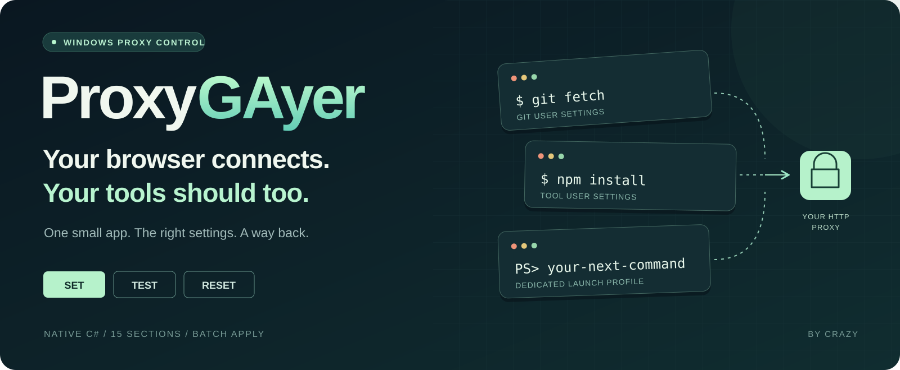
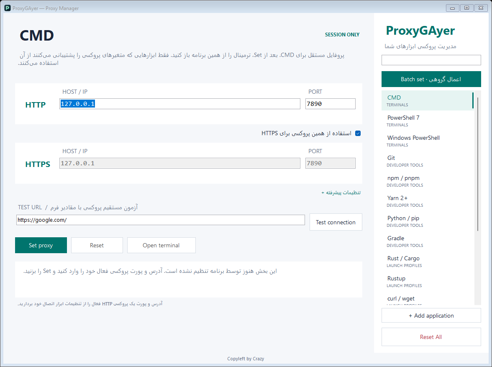
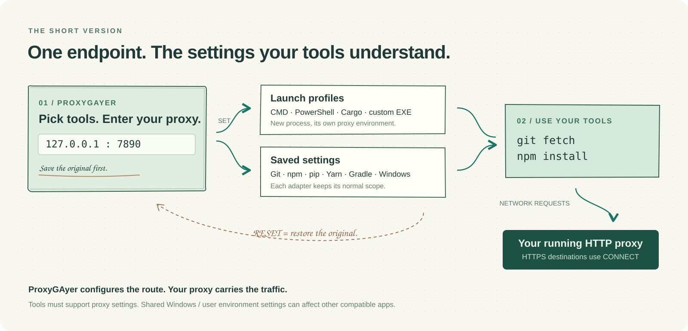
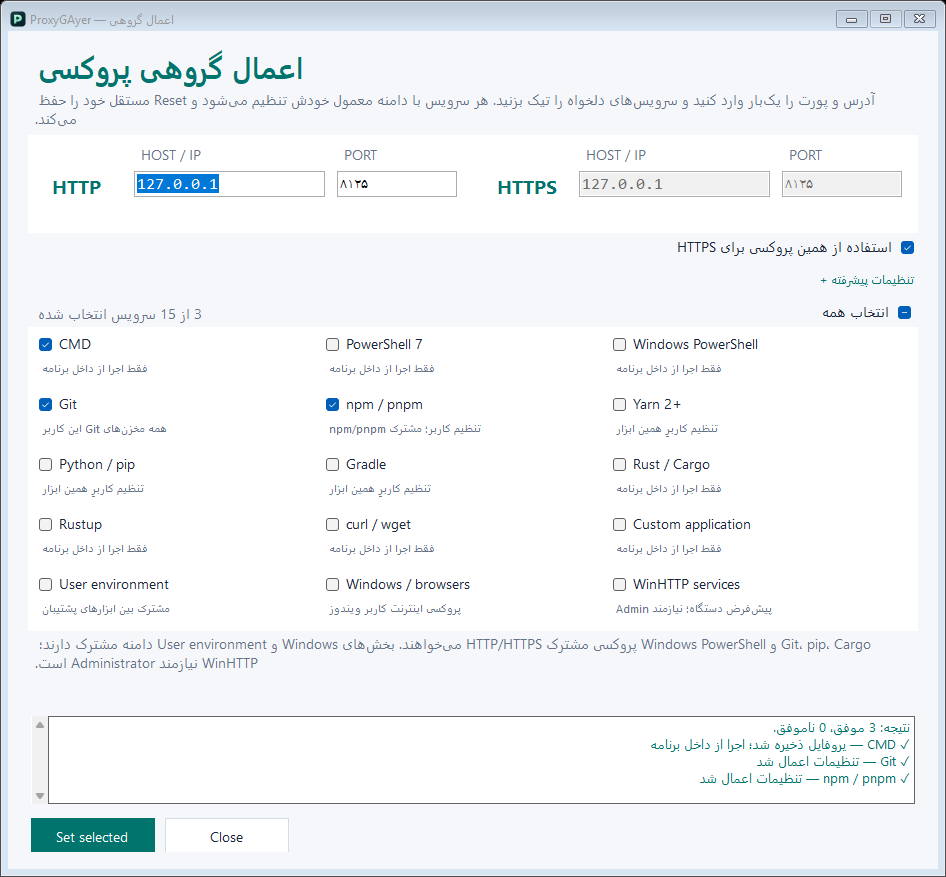
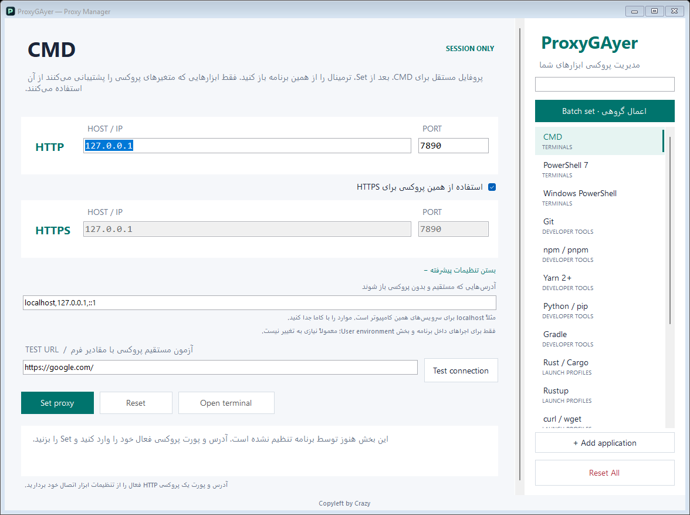

<p align="center">
  
</p>

<h1 align="center">ProxyGAyer</h1>

<p align="center">
  <strong>Set your proxy. Pick your tools. Keep your way back.</strong><br>
  A lightweight Windows app for the proxy settings scattered across your development tools.
</p>

<p align="center">
  <kbd>Windows 10 / 11</kbd> &nbsp; <kbd>C# · WinForms</kbd> &nbsp; <kbd>15 built-in sections</kbd> &nbsp; <kbd>Batch apply</kbd>
</p>

<p align="center">
  <a href="#quickstart">Get started</a> ·
  <a href="#batch-apply">Apply to multiple tools</a> ·
  <a href="#supported-tools">Supported tools</a> ·
  <a href="#troubleshooting">Fix a connection</a> ·
  <a href="README.fa.md">فارسی</a>
</p>

---

## Browser online. Git stuck. Sound familiar?

Your proxy is running. Your browser works. Then `git fetch` times out, `npm install` stalls, and a new terminal behaves differently from the last one.

**ProxyGAyer puts those settings in one place.** Choose a tool, enter your proxy's host and port, then set, test, or restore its configuration. Need the same endpoint in several places? Select the tools and apply it in a batch.

<p align="center">
  
  <br><sub>Real app capture with demo values. The UI uses Persian text and English tool names.</sub>
</p>

## Less configuration archaeology

| The annoying part | The useful part |
| --- | --- |
| Remembering a different proxy command for every tool | Host, port, **Set proxy**. The adapter handles the tool's configuration. |
| Re-entering the same endpoint five times | **Batch set** with individual checkboxes and **Select all**. |
| Wondering what “global” actually changes | Scope labels distinguish launch profiles, tool user settings, and shared Windows settings. |
| Forgetting what was there before | **Reset** restores the state before the first Set. **Reset All** handles the configured sections. |
| A saved setting that still cannot connect | **Test connection** sends a real HTTP or HTTPS request through the entered proxy. |

The app uses native Windows Forms, has zero third-party NuGet dependencies, and runs without a background service. The current build uses the installed .NET Desktop Runtime to keep the app package small.

## Quickstart

### Download a release

Open [Releases](https://github.com/SprTybi/ProxyGAyer/releases) and choose a build:

- **Standalone EXE:** .NET is included; run the single file directly.
- **Small EXE / ZIP:** install [.NET 10 Desktop Runtime](https://dotnet.microsoft.com/en-us/download/dotnet/10.0) first.

Both target Windows 10/11 x64. The standalone download is larger because it includes its runtime.

### Build from this checkout

On Windows, install the [.NET 10 SDK](https://dotnet.microsoft.com/en-us/download/dotnet/10.0) and Git, then run these commands in the repository root:

```powershell
.\build.ps1
.\artifacts\ProxyGAyer\ProxyGAyer.exe
```

The script runs the checks, publishes the app, and creates `artifacts/ProxyGAyer-win-x64.zip`.

<details>
<summary><strong>Already have a packaged build?</strong></summary>

The standalone EXE includes .NET and needs no adjacent DLLs. The small EXE and ZIP require the **.NET 10 Desktop Runtime** from the [.NET download page](https://dotnet.microsoft.com/en-us/download/dotnet/10.0). Extract ZIP builds before running them. If you use the regular folder build from `build.ps1`, keep its DLLs and runtime configuration beside the executable.

</details>

### Give one tool a route out

1. Start your existing HTTP proxy and check the host and port it exposes.
2. Select a tool on the right.
3. Enter a host such as `127.0.0.1` and a port such as `7890`. These are examples; use **your proxy's actual values**.
4. Keep **use the same proxy for HTTPS** enabled unless you need different endpoints.
5. Click **Test connection**, then **Set proxy**. A successful test checks that endpoint and URL; it does not verify every tool's effective configuration.
6. For a launch profile, use **Open terminal** or **Launch application**. Run your command in that new session.

> **Bring a running HTTP proxy.** ProxyGAyer manages configuration. Your existing proxy provides the network connection.

## How it fits together

<p align="center">
  
</p>

## Batch apply

One endpoint. A handful of checkboxes. A result for every selected section.

1. Open **Batch set · اعمال گروهی**.
2. Enter the HTTP and HTTPS endpoint once.
3. Check the tools you want, or use **Select all**. Custom applications appear here too.
4. Click **Set selected** and review the individual results.

<p align="center">
  
</p>

Each section keeps its own backup and Reset behavior. A failure in one section is reported while other sections continue. If distinct HTTP and HTTPS endpoints are incompatible with a selected tool, the batch is rejected **before any section changes**.

**A checkbox selects an adapter, not an isolation boundary.** Selecting User environment or Windows settings can also affect compatible apps outside your selection. The scope beneath each checkbox tells you what you are changing.

## Supported tools

**Launch profile** means a profile is applied to a new process launched from ProxyGAyer. **Saved setting** means it updates a tool's user configuration or a Windows setting.

| Section | Mode | Actual scope / behavior |
| --- | --- | --- |
| **CMD** | Launch profile | Proxy-aware commands in the new terminal. Existing windows stay unchanged. |
| **PowerShell 7** | Launch profile | Proxy environment for the new session and its child processes. |
| **Windows PowerShell 5.1** | Launch profile | Environment plus that session's default .NET proxy. One endpoint; user shell profiles are skipped. |
| **Git** | Saved setting | User-global `http.proxy` for HTTP and HTTPS repositories. Repository and URL-specific settings may override it. |
| **npm / pnpm** | Saved setting | `proxy` and `https-proxy` in the user `.npmrc`, shared with compatible pnpm versions. |
| **Yarn 2+** | Saved setting | `httpProxy` and `httpsProxy` in the user's `.yarnrc.yml`. Project settings may override them. |
| **Python / pip** | Saved setting | `global.proxy` in `%APPDATA%/pip/pip.ini`. Virtual environment and explicit settings may override it. |
| **Gradle** | Saved setting | HTTP and HTTPS JVM proxy properties in the user's `gradle.properties`. Restart existing daemons. |
| **Rust / Cargo** | Launch profile | A terminal with `CARGO_HTTP_PROXY`. Uses one endpoint and leaves Cargo's files untouched. |
| **Rustup** | Launch profile | A terminal with the standard HTTP and HTTPS proxy environment. |
| **curl / wget** | Launch profile | A terminal with `http_proxy`, `https_proxy`, and `no_proxy`. Explicit tool options may take precedence. |
| **Custom application** | Launch profile | Choose an EXE and pass it proxy environment variables. The app must support them. |
| **User environment** | Shared user setting | Persistent environment variables for compatible apps. Restart apps; a new Windows sign-in may be needed. |
| **Windows / browsers** | Shared user setting | Manual Windows Internet proxy for apps that follow it. PAC and organization policies may take precedence. |
| **WinHTTP services** | Machine setting | Default proxy for services that use this WinHTTP configuration. Requires **Administrator**. |

Use **Add application** to create independent launch profiles for additional EXEs. They are included in the batch list automatically.

### What the current version covers

- HTTP proxies without username/password authentication, for HTTP and HTTPS destinations.
- HTTPS destinations through HTTP **CONNECT**, with TLS certificate verification kept enabled.
- Shared or separate endpoints where the adapter supports them. Git, pip, Cargo, and Windows PowerShell use one common endpoint.
- Proxy-aware tools and Windows settings respected by the destination application.

SSH remotes such as `git@github.com:…`, SOCKS, TLS connections to the proxy itself, UDP, Docker daemon configuration, and forced routing of arbitrary apps are outside the current implementation. Whole-system traffic routing needs a VPN, TUN, or another traffic-routing tool.

## A way back is part of the feature

**Reset means “restore what was there,” not “blindly delete every proxy.”**

- The original state is journaled **before** external configuration is written.
- Repeated Set operations preserve the first backup.
- A newly created configuration file is removed on Reset; an existing file is restored byte for byte.
- An external edit stops that section's restore, preserving the newer changes and the backup for review.
- An interrupted operation leaves a recoverable journal. Use Reset when the app reports a pending change.
- Reset All processes sections independently and reports failures. It does not close or reconfigure processes already launched.

## Troubleshooting

<details>
<summary><strong>Set worked, but Git or another tool still times out.</strong></summary>

Check that your proxy is running and that its host, port, and protocol match the form. Test an HTTP URL and an HTTPS URL separately. A repository config, virtual environment, project config, command-line option, or organization policy may take precedence over a user setting. Git SSH remotes use a different transport and are not covered by the HTTP adapter.

For Test results: redirects are not followed, so use the final URL for a `3xx` response. A `407` response indicates proxy authentication, which the current UI does not support. TLS validation remains enabled; certificate errors need a valid trust configuration.

</details>

<details>
<summary><strong>My old CMD / PowerShell window did not change.</strong></summary>

Launch profiles apply to newly started processes. Set the profile, then use **Open terminal**. Reset does not rewrite a running process's environment; close that session when you want to stop using its settings. PowerShell launch profiles use `-NoProfile`, and CMD uses `/D` to skip AutoRun.

</details>

<details>
<summary><strong>What does “global” mean here?</strong></summary>

Git's setting is global **within that user's Git configuration**, so it can affect all their Git repositories. Launch profiles apply to a newly launched process. User environment and Windows Internet settings are shared more broadly; WinHTTP changes a machine default. Tools may also inherit shared settings or use fallbacks, so independent entries do not guarantee total network isolation.

</details>

<details>
<summary><strong>What is the advanced “direct connection” field?</strong></summary>

It edits `NO_PROXY`: destinations that compatible tools should reach directly. `localhost`, `127.0.0.1`, and `::1` refer to this computer. Separate entries with commas. The field starts collapsed and is shown only for launch profiles or User environment. You can usually keep the default. Connection testing deliberately ignores bypass rules to exercise the proxy route.



</details>

<details>
<summary><strong>WinHTTP failed while other batch entries succeeded.</strong></summary>

WinHTTP changes require Administrator access. Run the app with **Run as administrator** when you need that adapter. The app does not automatically elevate. Review each batch result; a failed entry does not imply the successful ones were reverted.

</details>

<details>
<summary><strong>Reset says the settings changed outside the app.</strong></summary>

The app compares the current resource with its journal before restoring. It stops rather than overwrite a newer file or registry value. Keep the backup, review the external change, and reconcile it with the last recorded state before retrying Reset. Symbolic-link files and some complex YAML structures are also rejected for direct editing; a launch profile is an alternative for compatible applications.

</details>

<details>
<summary><strong>Where are settings and backups stored?</strong></summary>

`%LOCALAPPDATA%/ProxyGAyer/state.json` contains profiles and recovery data. Backups can contain complete configuration files, including credentials already present in them. Keep this file private and retain it until any needed Reset is complete. Public screenshots in this repository use isolated demo settings.

</details>

## Build, verify, extend

```powershell
# Run the checks, publish the app, and package it.
.\build.ps1

# Build single-file light + standalone EXEs, a ZIP, and checksums.
.\build-release.ps1 -Version 1.0.0

# Refresh the README screenshots after building. Close the app first.
.\scripts\update-screenshots.ps1
```

The build requires the .NET 10 SDK and Windows Desktop targeting pack already installed. `NuGet.Config` clears package feeds because the app has no third-party package dependencies. Git is used to verify the real configuration parser. The checks exercise isolated resource stores, workspace fixtures, and local proxy servers, including HTTP forwarding and HTTPS CONNECT; they leave your actual proxy settings untouched.

`build-release.ps1` uses Microsoft's SDK/runtime packages from the official NuGet feed when needed. Outputs stay in this repository's ignored `artifacts/releases/v1.0.0` directory. Push a version tag, or run **Actions → Release** on GitHub, to build and publish release assets automatically. See the [release guide](docs/RELEASING.fa.md); running the local build script alone does not publish anything.

Screenshot capture uses the app's `--preview` mode. It exercises Set / Reset, Reset All, batch selection, and endpoint validation against in-memory resources. Only the PNGs are copied into `docs/assets/`; private state and generated builds stay outside those public assets.

```text
src/ProxyGAyer/          Native UI, batch selection, advanced settings
src/ProxyGAyer.Core/     Adapters, scope, profiles, journals, connection test
tests/ProxyGAyer.Tests/  Dependency-free verification harness
docs/assets/            Original SVG artwork and actual app screenshots
scripts/                Screenshot and icon authoring helpers
.github/workflows/      Tag-triggered and manual release publishing
```

Adding a native integration? Start with [`ServiceCatalog`](src/ProxyGAyer.Core/Models.cs) and [`ConfigPlanner`](src/ProxyGAyer.Core/ConfigPlanner.cs), state its scope, and cover restore behavior. For a bug report, include the section, OS / tool version, and relevant result text, with credentials removed.

<p align="center">
  <sub>Copyleft by Crazy · <a href="README.fa.md">نسخهٔ فارسی</a></sub>
</p>
